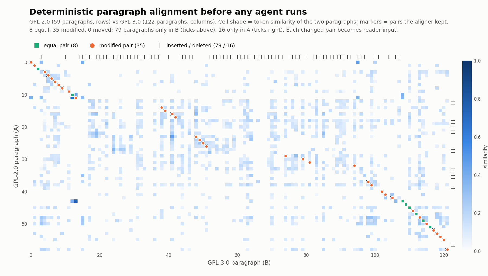
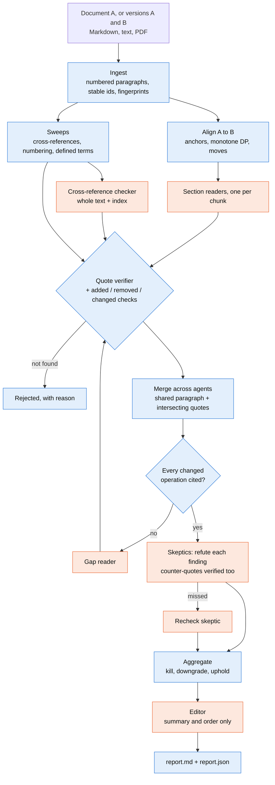

# Grounded Multi-Agent Document Audit

**A multi-agent pipeline that audits one long document, or compares two versions of it, where no finding reaches the report on an agent's word. Code checks every quoted piece of evidence against numbered source paragraphs and rejects what it cannot find, checks that text claimed as "added" is really absent from the old version, and measures which changes no agent cited. Every surviving finding then goes to a skeptic agent whose job is to refute it, and the final editor may reorder findings but never add, upgrade or resurrect one.**

| | |
|---|---|
| **What it is** | Two modes. Audit: one document, looking for contradictions, broken references, undefined terms and gaps. Diff: version A vs B, every substantive change. Deterministic ingest, paragraph alignment, sweeps, quote verification, merge, coverage and severity aggregation in Python; LLM section readers, a cross-reference checker, a gap reader, skeptics and an editor in between. Markdown and JSON reports with every finding linked to its paragraphs |
| **Result** | Real multi-agent run (Claude Code Workflow runner, Claude Opus 5.5 agents) on a 13-change planted benchmark: diff recall **1.00** (13/13), precision **1.00** (17/17 scored findings), 0 of 5 editorial edits flagged, against precision **0.87** for the no-LLM baseline (`examples/results/planted-diff-claude-workflow/score.json`). The quote verifier rejected 3 of 24 agent findings before any skeptic saw them. Offline fixture runs: it rejected all **10 of 10** injected fabricated quotes on GPL-2.0 vs GPL-3.0 and nothing else (`tests/test_pipeline.py`). Python runner on the API and audit mode: pending |
| **Stack** | Python standard library core (PyMuPDF optional for PDF), Anthropic Messages API with structured outputs, a Claude Code Workflow script (JavaScript) as a second runner, pytest, Node for the offline workflow test. Full suite run on Python 3.14; the committed fixture results reproduce byte for byte on 3.12 |
| **Tests** | 91 offline tests on CPU in about 25 s, no API key, no network. They include running the Workflow script under mocked hooks, in diff and audit mode, and requiring byte-identical agent files and the same report body (findings, verdicts, pipeline statistics) as the Python runner |



*The deterministic layer before any agent runs: token similarity of every GPL-2.0 paragraph (rows) against every GPL-3.0 paragraph (columns), and the pairs the aligner kept. Each changed pair, insertion and deletion becomes input for a section reader, and coverage of these operations is measured at the end. Rendered by `scripts/render_hero.py`.*

---

## How it works



Orange boxes are agents; blue boxes are plain Python. The agents never write the report.

1. **Ingest and align.** Paragraph ids (`p0001`, ...) are a pure function of the file bytes. A fingerprint of the normalised text makes re-wrapping, typographic quotes and line-break hyphens invisible. In diff mode, unique unchanged paragraphs anchor a monotone dynamic programme; leftovers that are near-identical become moves.
2. **Sweeps.** Cross-references such as `Section 3(a)(1)(A)(i)` are resolved against the document's own list structure; list numbering is checked for gaps. A dangling reference becomes a finding without any model call.
3. **Readers and checker.** Section readers each get one chunk of alignment operations (or paragraphs); the cross-reference checker gets the whole text plus the deterministic index and looks for what chunk readers cannot see.
4. **Quote verifier.** Every evidence item is `{doc, para_id, quote}`. A quote must be in the cited paragraph exactly, after normalisation, or as verbatim segments joined by `...`; a quote in the wrong paragraph is re-attributed and flagged; anything else rejects the finding. Diff claims are checked too: text quoted as *added* must not occur anywhere in A, text quoted as *removed* must not occur anywhere in B, and a *changed* claim must quote something that differs.
5. **Merge and coverage.** Findings from different agents that cite the same paragraph with intersecting quotes become one finding with a noisy-OR confidence. In diff mode every changed alignment operation must be cited by some finding; the rest goes to a gap reader that must report it or name it editorial.
6. **Skeptics, then the editor.** Each finding goes to a skeptic told to refute it. A refutation needs verified counter-quotes, otherwise it only counts as weakening; a strict majority of grounded refutations kills a finding. The editor writes the summary; code drops any id that did not survive and flags any quote in the summary that is not in the documents.

Design details, the full rule tables and the failure analysis: [`docs/DESIGN.md`](docs/DESIGN.md).

## Results

Every number below comes from a committed file or a test.

| Measurement | Value | Source |
|---|---|---|
| Planted benchmark | 13 substantive changes, 5 editorial edits, 1 banner on the CC BY 4.0 legal code (4 items also scored in audit mode) | `examples/planted/ground_truth.json` |
| Alignment of the planted pair | exactly 16 changed operations: the 13 planted changes, the 2 editorial edits that change words, the banner. Re-wrapping, typographic quotes and line-break hyphenation produce none | `tests/test_align.py` |
| **Diff baseline, no LLM** (every changed operation reported) | recall **1.00** (13/13), precision **0.87** (13/15); the 2 false positives are the spelling and serial-comma edits | `examples/results/planted-diff-fixture/score-baseline.json` |
| **Audit baseline, no LLM** (deterministic sweeps only) | recall **0.50** (2/4: dangling reference, numbering gap), precision **1.00** | `examples/results/planted-audit-fixture/score-baseline.json` |
| GPL-2.0 vs GPL-3.0 alignment | 59 vs 122 paragraphs: 8 equal, 35 modified, 79 inserted, 16 deleted | `examples/results/gpl-v2-v3-fixture/report.json` |
| **Claude, Workflow runner, diff mode** (one run, Claude Opus 5.5 agents, 14 agent calls, at most 1 at a time, 12 min) | recall **1.00** (13/13, all 12 change categories), precision **1.00** (17/17); 0 editorial edits flagged; 3 of 24 agent findings rejected by the quote verifier (a finding kind that diff mode does not allow); 0 findings killed by the skeptics | `examples/results/planted-diff-claude-workflow/score.json`, full run directory next to it |
| Claude, Python runner on the API; audit mode | **pending** | will be committed under `examples/results/` |

The baseline sets the bar. In diff mode the agents have to keep recall at 1.00 while removing editorial noise and rating each change; in audit mode they have to find the contradiction and the undefined term that no sweep can see. The real Workflow run did the diff half of that: recall stayed at 1.00 and both editorial false positives of the baseline were gone. It is one run on a small benchmark (13 planted changes), so treat it as a working demonstration, not a precision estimate.

**Fixture runs (plumbing, not model quality).** The scripted FakeLLM backend injects faults on a fixed schedule (fabricated quotes, wrong paragraph ids, case-changed quotes, skipped operations) so every stage runs offline on real text. From `examples/results/*/report.md`:

| Fixture run | Agent findings | Rejected by verifier | Re-attributed | Coverage, first pass -> after gap reader | Skeptic outcome |
|---|---|---|---|---|---|
| GPL-2.0 vs GPL-3.0, diff | 130 | 10 (all 10 injected fabrications) | 8 | 74.6% -> 87.7% | 87 upheld, 43 downgraded; 16 missed findings rechecked |
| Planted, diff | 20 | 1 (the 1 injected fabrication) | 1 | 87.5% -> 93.8% | 11 upheld, 4 downgraded, 2 killed (the 2 editorial edits); 1 ungrounded refutation downgraded instead of killing |

That every injected fabrication is rejected, and nothing else, is asserted in `tests/test_pipeline.py`. The fixture's own recall and precision (`score-fixture.json`) are circular by construction and are not claimed as results.

## How to run

Requirements: Python 3.12+ (test suite run on 3.14; the fixture pipeline also checked on 3.12). The core has no third-party dependencies. Optional extras in `pyproject.toml`: `pip install -e ".[dev]"` for pytest and jsonschema, `.[pdf]` for PyMuPDF, `.[anthropic]` for real runs. Node runs the workflow test. Tests that need Node, PyMuPDF or jsonschema are skipped when those are missing. All commands run from the repository root.

**Tests and the offline demo (no key, CPU only):**

```bash
python -m pytest
python -m docaudit run --mode diff --a examples/planted/cc-by-4.0.txt --b examples/planted/cc-by-4.0-planted.txt --run runs/demo --backend fake
python -m docaudit baseline --run runs/demo
python -m docaudit score --run runs/demo --truth examples/planted/ground_truth.json --source baseline
```

The demo writes `runs/demo/report.md`; it is labelled as a fixture run.

**Real pass with the Python runner (Anthropic API):**

```bash
pip install anthropic
export ANTHROPIC_API_KEY=...          # or: ant auth login
export DOCAUDIT_MODEL=claude-opus-5-5
python -m docaudit run --mode diff --a examples/planted/cc-by-4.0.txt --b examples/planted/cc-by-4.0-planted.txt \
  --run runs/planted-diff-claude --backend anthropic --max-cost-usd 5 --concurrency 4
python -m docaudit score --run runs/planted-diff-claude --truth examples/planted/ground_truth.json
```

Every role answers through structured outputs (JSON schema); effort is set per role, the cross-reference checker and the skeptics get the full documents as a prompt-cached prefix, retries use exponential backoff, and `--max-cost-usd`, `--max-input-tokens` and `--max-output-tokens` stop new calls once reached. A run that stops early (missing credentials, a cap) still writes a report marked incomplete and exits with status 3. Audit mode: `--mode audit --a <file>`. Any Markdown, text or PDF file works.

**Real pass with the Claude Code Workflow runner** (at most 2 agents at a time):

```bash
python -m docaudit prepare --mode diff --a examples/planted/cc-by-4.0.txt --b examples/planted/cc-by-4.0-planted.txt \
  --run runs/planted-diff-workflow --skeptic-batches 4
```

Then, in a Claude Code session in this directory, run the Workflow script `workflow/document-audit.workflow.js` with `args` set to the contents of `runs/planted-diff-workflow/workflow_args.json`. It writes `agents/*.json`, runs the deterministic stages through the `docaudit` CLI and ends with `report.md` and `report.json`; score it with the same `score` command. Details: [`workflow/README.md`](workflow/README.md). Evaluation protocol: [`docs/EVALUATION.md`](docs/EVALUATION.md).

## Repository layout

```
docaudit/                 the package (python -m docaudit ...)
  ingest.py               Markdown / text / PDF -> numbered paragraphs and sections
  align.py                paragraph alignment A -> B (anchors, DP, moves)
  sweeps.py               cross-references, numbering gaps, defined terms
  verify.py               quote verifier and diff-claim checks
  merge.py                cross-agent merge, coverage
  aggregate.py            skeptic verdicts -> status, severity, confidence
  report.py               report.md / report.json, editor checks
  stages.py               deterministic stages shared by both runners
  schemas.py, prompts.py  role schemas and role instructions
  roles.py                builds each agent request from the run directory
  pipeline.py, budget.py  Python runner: concurrency, retries, token and cost caps
  llm/                    Anthropic backend, scripted FakeLLM, interface
  evaluation.py           baseline and scorer
workflow/                 Claude Code Workflow runner (JavaScript) and its README
examples/gpl/             GPL-2.0 and GPL-3.0 texts (demo pair)
examples/planted/         CC BY 4.0 legal code, planted copy, ground truth
examples/results/         committed baseline scores and fixture reports
scripts/                  make_planted.py, reproduce_results.py, render_hero.py
tests/                    91 offline tests, plus the Node driver for the workflow test
docs/                     DESIGN.md, EVALUATION.md, RELEASE_ASSETS.md, hero.png
```

## Limitations and honest scope

- **One real model run, diff mode only.** The committed real run is the Claude Code Workflow runner in diff mode (`examples/results/planted-diff-claude-workflow/`); audit mode with real agents is still pending, and the other folders under `examples/results/` are the no-LLM baseline and FakeLLM fixture runs. The Python Anthropic backend is tested against a mocked client only; the build machine had an old `anthropic` SDK (0.40), so newer request fields (`output_config`, `thinking`, `fallbacks`) are sent through `extra_body` and have not been exercised against the live API here.
- **The benchmark is small and self-made**: 13 substantive and 5 editorial edits in one 18 KB legal text. It is a regression test and a sanity check, not a measure of model quality. Matching is at paragraph level, so a finding that cites the right paragraph for the wrong reason still counts as found.
- **A verified quote proves the text exists, not that the reading is right.** Interpretation is checked by skeptics, which are models too; their refutations must quote, but their judgement is not verified by code.
- **The absence check is lexical.** A clause that was reworded and moved can pass as "added". The prompts and the cross-reference checker target this case; the code cannot rule it out.
- **Alignment is paragraph-level.** Heavy rewrites such as GPL-2.0 to GPL-3.0 produce many insert and delete operations rather than sentence-level pairs. Heading detection is tuned on plain-text legal documents and Markdown; PDF input uses PyMuPDF text blocks without table or header/footer handling.
- **Cost caps use a static price table** (cached November 2026, overridable by environment variables) and an output estimate per call, so a call already in flight can overshoot a cap by one response per worker.

## License

Code: MIT, see [`LICENSE`](LICENSE). The example documents keep their own terms (GPL texts: verbatim copying only, unmodified here; CC BY 4.0 legal code: CC0; the planted copy is a test fixture, not a license). See [`NOTICE.md`](NOTICE.md).
